# 幻镜手机 · Mirage Phone

> 给 SillyTavern 的一部手机。和角色卡里的人聊天、约会、刷社交 App，还能把这一切写回正文。

[](#)
[](https://github.com/SillyTavern/SillyTavern)
[](LICENSE)
[](#)

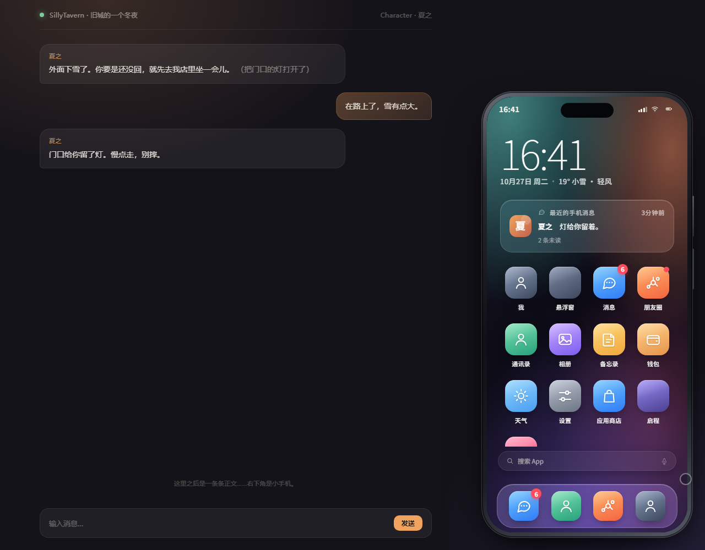

---

## 这是什么

不是把聊天框换个皮，而是一部**独立的小手机**：

- **和「人」聊天** — 通讯录里不是角色卡，而是卡里的人物；聊天用那个人的身份和说话方式
- **应用商店** — 抖音、微博、小红书、B 站、X、Instagram、Reddit、知乎、Quora、YouTube、Discord、Telegram、Spotify、Gmail，界面照着真实 App 重画
- **剧情工具** — 启程摇剧情、相遇找人约会，结果写进酒馆正文
- **独立生成** — 手机里的回复由酒馆当前模型在后台生成，不占正文上下文
- **双向联动** — 手机消息可摘要进正文，正文也可以触发主动来信
- **一段剧情一部手机** — 数据存在当前聊天的 chat metadata

| 消息 | 应用商店 | Instagram |
| --- | --- | --- |
| 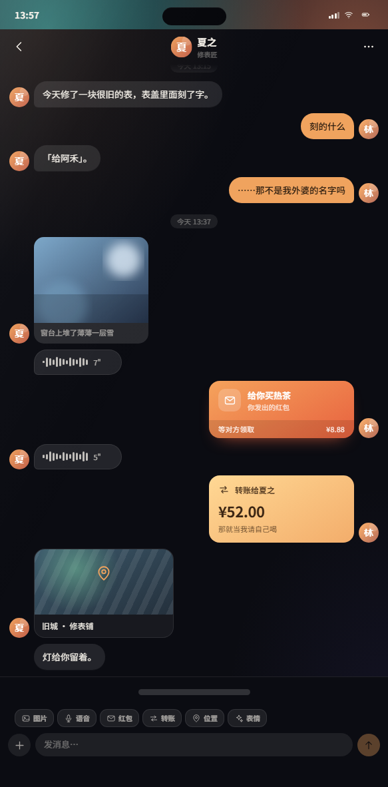 | 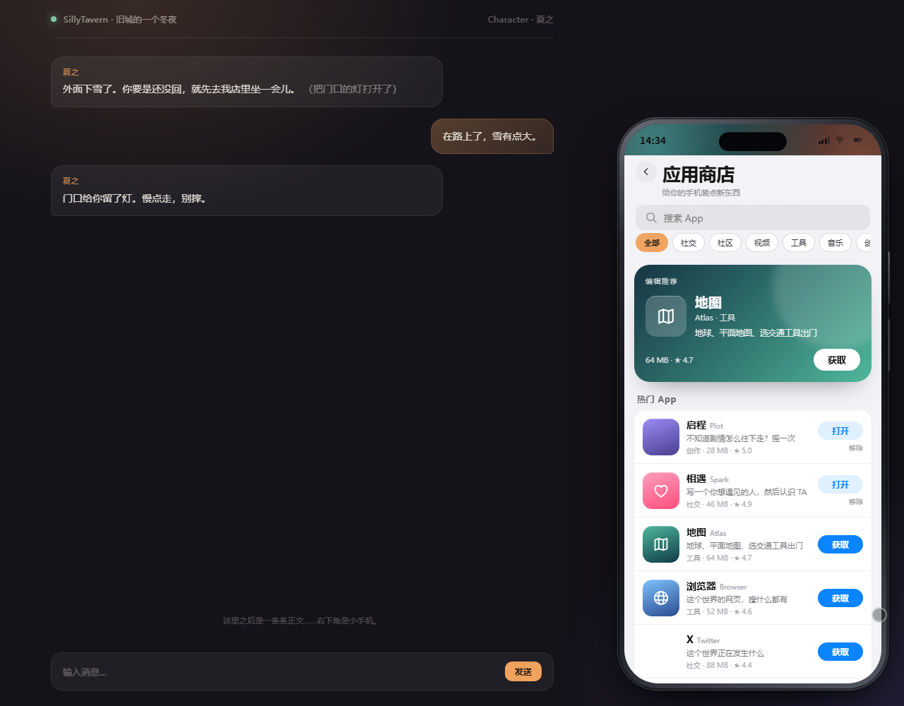 | 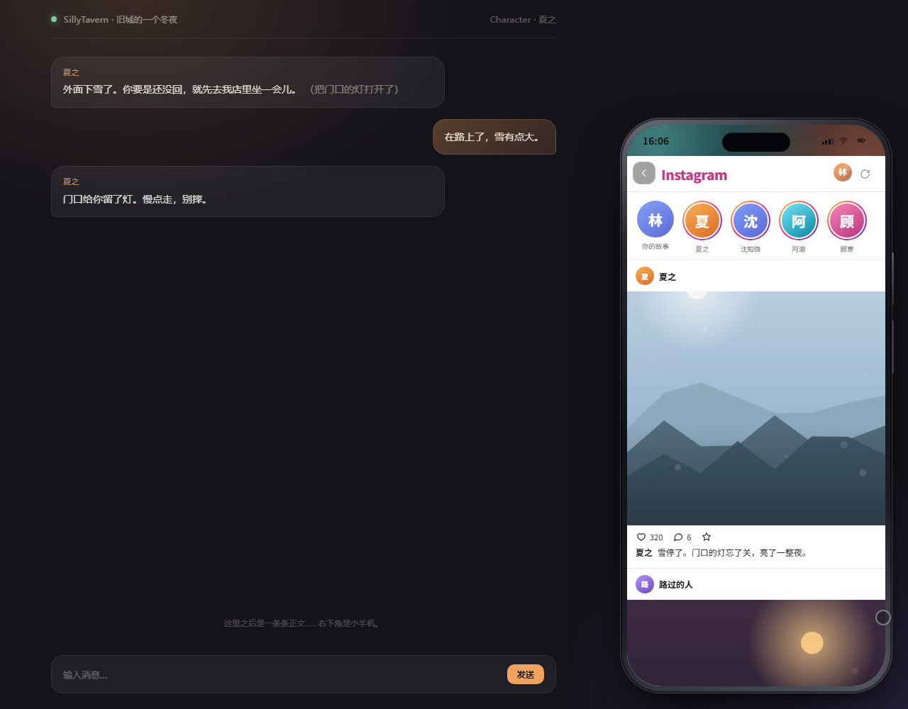 |

| 地图 | 股市 | 我 |
| --- | --- | --- |
| 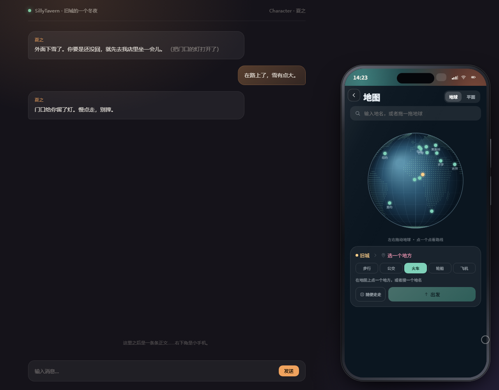 | 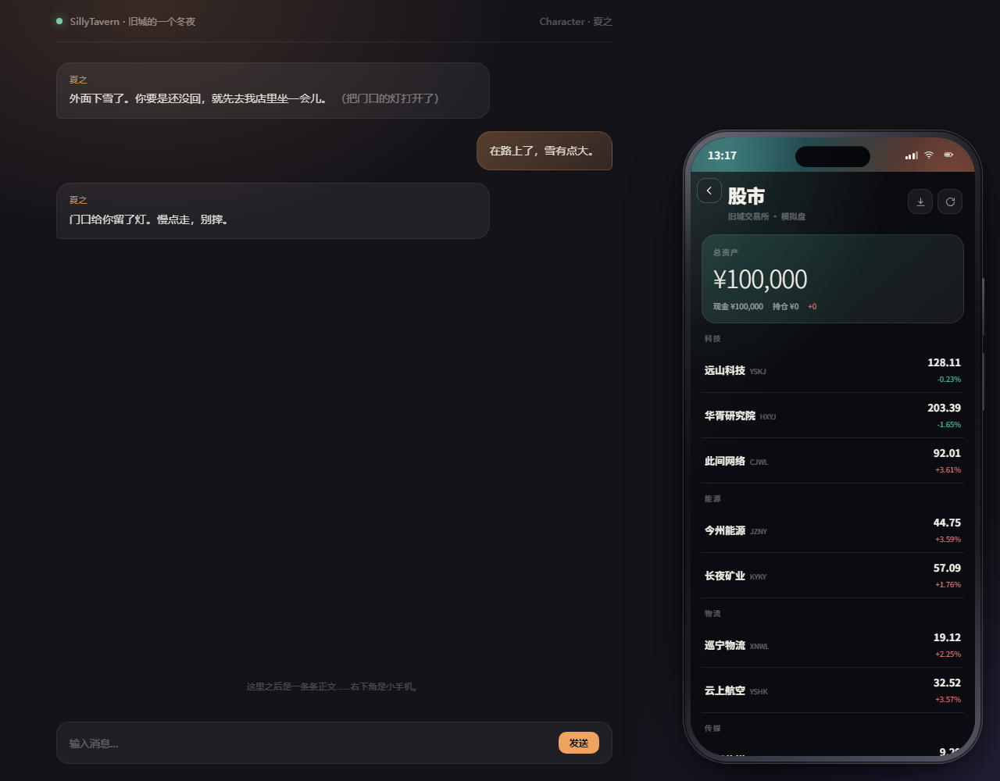 | 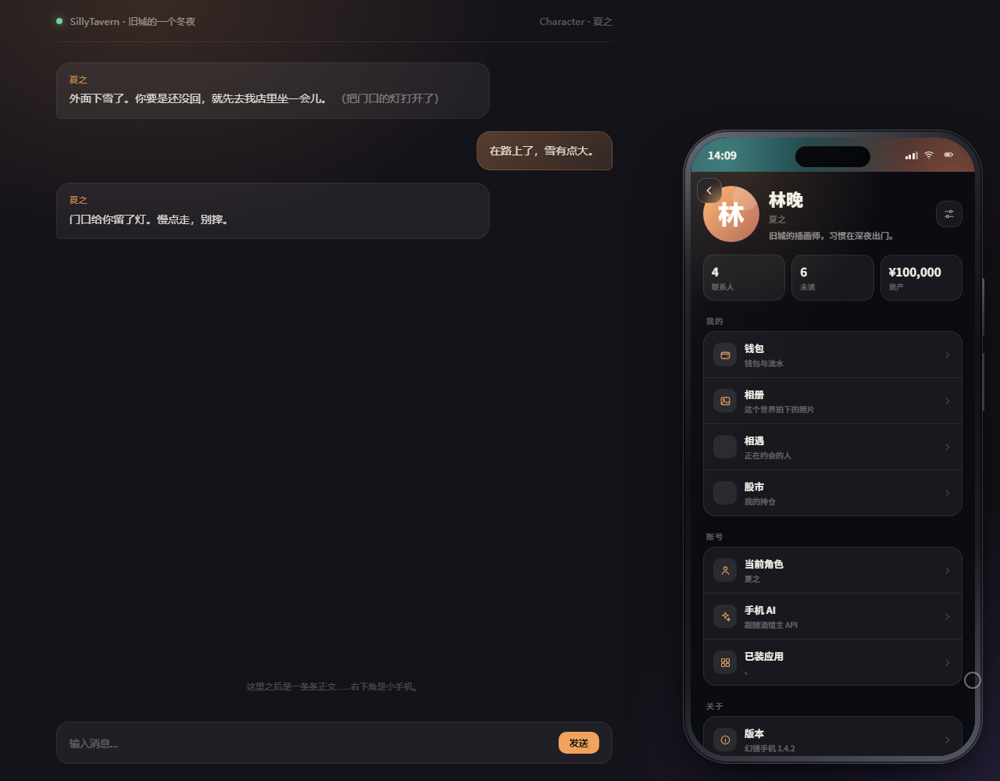 |

## 宣传片

12 秒，无声，竖屏。

[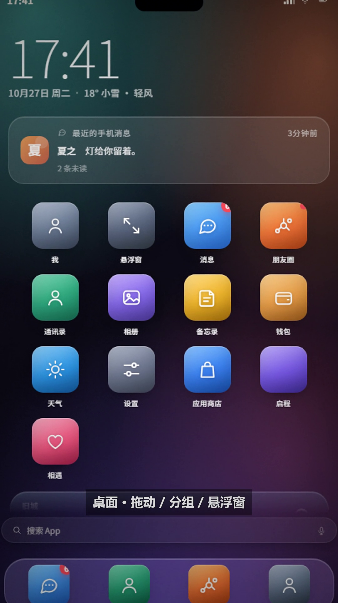](docs/promo.mp4)

[▶ 播放 docs/promo.mp4](docs/promo.mp4)

## 功能

### 手机
- 可拖动、可缩放（0.55×–1.65×）、全屏 / 悬浮窗切换
- 灵动岛通知、状态栏、双击灵动岛切窗口、右下角缩放圆点
- 深色 / 浅色 / 跟随系统、六种强调色、五张壁纸、可上传照片
- 主屏图标**拖动排序**、拖到别的图标上**建分组**、长按菜单、文件夹管理
- 主屏搜索、未读角标、最近消息、天气小组件

### 人
- 「找人物」从角色卡提取世界内人物（名字 / 身份 / 关系 / 人设 / 说话方式）
- 手动添加、编辑、移除；群聊；关系备注
- 多气泡、语音、图片、红包、转账、位置、表情；长按复制 / 带进正文 / 删除

### 剧情工具
- **启程**：激进 / 梦幻 / 平凡 / 一般四种基调；摇一个推进，或自己写一句直接写进酒馆
- **相遇**：描述想要的人 → AI 候选人 → 心动 / 约会；约会以用户消息发进酒馆并触发 AI 回复，对象设定一并注入

### 应用
| App | 玩法 |
| --- | --- |
| 抖音 | 全屏竖滑、点赞、评论、整页播放 |
| 微博 | 热搜、动态、转发、评论 |
| 小红书 | 双列笔记、整页详情、评论 |
| B 站 | 双列视频、弹幕、播放页 |
| YouTube | 双列视频、播放页、评论 |
| X | 时间线、发帖、详情 |
| Instagram | 故事栏、单列大图、点赞/评论/收藏、整页详情 |
| Reddit / 知乎 / Quora | 帖子/问答、发帖、详情、评论 |
| Discord | 服务器 / 频道切换、新建、发消息 |
| Telegram | 会话列表、群组、整页聊天 |
| 心 | 关系阶段、好感、喜欢怎样靠近、敏感带、今天穿着、边界；自己的颜值/性格/身体/家世/喜恶 |
| 世界 | 世界名称、类型、范围大小、时代、规则、势力、地点，可自己编辑 |
| 拼多多 / 淘宝 / 京东 / Amazon | 商品流、搜索、详情、购物车，商品可按正文生成 |
| Google / Yandex | 按正文和记忆生成搜索结果，点开是整页 |
| Wikipedia | 生成这个世界的人物、地点、事件条目 |
| Z-Library | 生成电子书搜索结果，可下载到手机书库 |
| 自定义头像 | 长按通讯录人物换头像；点「我的名片」换自己的头像 |
| AI | 按正文、记忆库、私聊和其它 App 的内容回答问题 |
| DeepSeek / ChatGPT / Claude / Gemini | 四个独立 AI App，各用各的 Key 和模型，读同一份本地资料 |
| Spotify | 歌单、正在播放 |
| Gmail | 收件箱、邮件详情 |
| 地图 | 地球/平面、城市搜索、交通方式、航线、出发 |
| 浏览器 | 地址栏、搜索、生成网页、历史删除 |
| 股市 | 12 家内置公司、买卖、持仓、从正文同步新公司 |

## 兼容性

| 平台 | 说明 |
| --- | --- |
| Windows / macOS / Linux | 桌面浏览器（Chrome / Edge / Firefox），推荐 |
| Android | 手机浏览器打开酒馆，界面自动全屏适配 |
| HarmonyOS | 鸿蒙浏览器 / WebView，同上 |
| iOS / iPadOS | Safari，支持安全区与触摸 |

需要 **SillyTavern 1.13.0+**，已在 **1.18.0** 实测。手机是酒馆里的浏览器扩展，没有原生 App。

窄屏布局已在 390–500px 宽度验证：图标四列不溢出、输入区贴底、快速操作栏横向滑动、安全区留白。

| 手机主屏 | 手机聊天 | 手机商店 |
| --- | --- | --- |
| 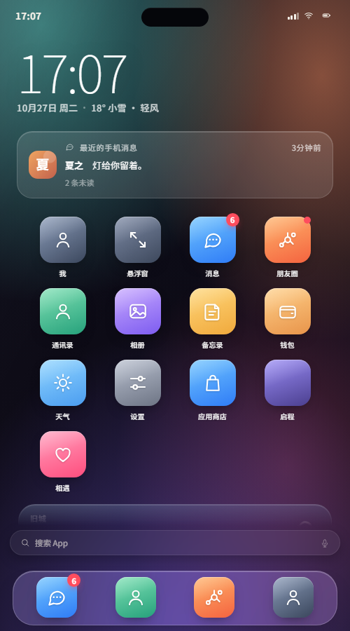 | 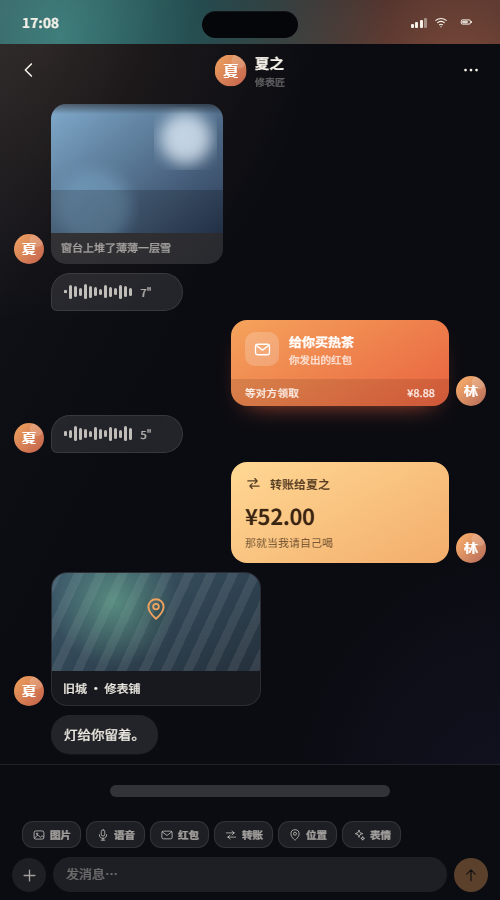 | 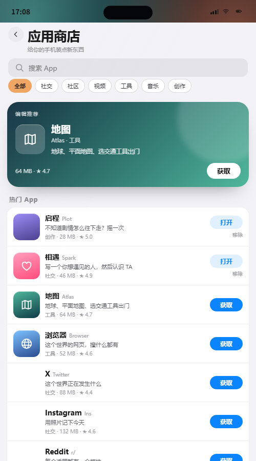 |

## 安装

### Git URL

仓库地址：

```text
https://github.com/jbozhang61-byte/st-mirage-phone
```

1. 酒馆 → **扩展** → **安装扩展**
2. 填上面的仓库地址
3. 刷新页面，右下角出现手机图标

也可以在酒馆的扩展目录里直接克隆：

```bash
git clone https://github.com/jbozhang61-byte/st-mirage-phone.git
```

> 仓库是公开的，直接填地址安装即可。

### 手动
```text
SillyTavern/data/<用户名>/extensions/third-party/st-mirage-phone/
```

## 第一次用

1. 打开角色卡
2. 点右下角手机 → **通讯录** → **找人物**
3. 选一个人聊天
4. 推进剧情 → **启程**；认识人 → **相遇**
5. 装 App → **应用商店**

## 设置

- **手机 AI 接口**：默认跟随主 API；也可填自己的 OpenAI 兼容地址 / Key / 模型，失败自动回退
- **AI 配图**：OpenAI 兼容或 SD WebUI；没配置时用内置程序化照片
- **评论风格**：真实网友 / 温柔 / 毒舌 / 二次元 / 文艺 / 简短
- **性能模式**：自动 / 流畅 / 完整；低配自动关掉毛玻璃、阴影和动画

## 数据与隐私

| 内容 | 位置 |
| --- | --- |
| 聊天、人物、朋友圈、App 缓存、股市 | 当前聊天的 `chatMetadata.mirage_phone` |
| 主题、壁纸、AI 设置、已装 App | `extension_settings.mirage_phone` |
| 上传的照片、自定义壁纸 | 浏览器 localStorage |

不会上传到第三方服务器；调用的是你自己配置的模型/生图接口。

## 开发

```bash
npm run serve      # http://127.0.0.1:7788/preview/
npm test           # 单元测试
node tools/audit.mjs
node tools/shot.mjs "http://127.0.0.1:7788/preview/?app=store" shots/store.png 1280 1000
```

```text
index.js              扩展入口：挂载、事件、注入、设置面板
src/
  phone.js            手机外壳、路由、拖拽缩放、灵动岛
  st.js               酒馆桥接（generateRawData / 注入 / 写回聊天）
  state.js            默认值与数据迁移
  store.js            当前聊天数据、人物、App 安装
  ai.js               回复、人物提取、内容、评论、股市
  prompts.js          提示词与解析（有测试）
  feed.js / social.js 内容 App 配方
  app-meta.js         应用目录
  apps/               每个 App 一个文件
css/                  外壳、内置 App、内容 App
preview/              不依赖酒馆的预览环境
test/                 单元测试
tools/                本地调试与截图
```

## 常见问题

**找人物失败？** 模型没按 JSON 回或卡里缺少人物描述；重试、换模型，或手动添加。

**评论区是空的？** 评论由 API 生成，第一次要等几秒；失败可以重试。

**约会没写进聊天？** 需要先打开角色聊天；约会会以用户消息发送并触发一次生成。

**换聊天手机空了？** 每个聊天一部手机；可用设置里的导出/导入。

## License

[MIT](LICENSE)